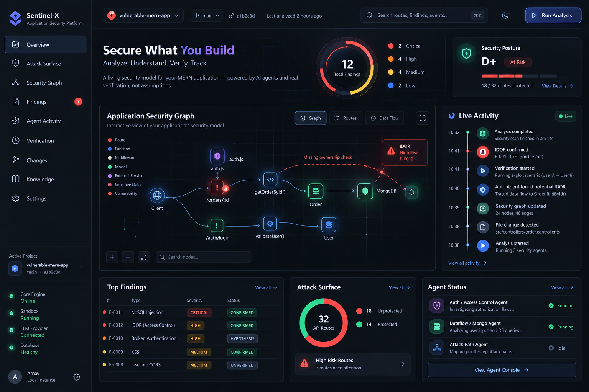
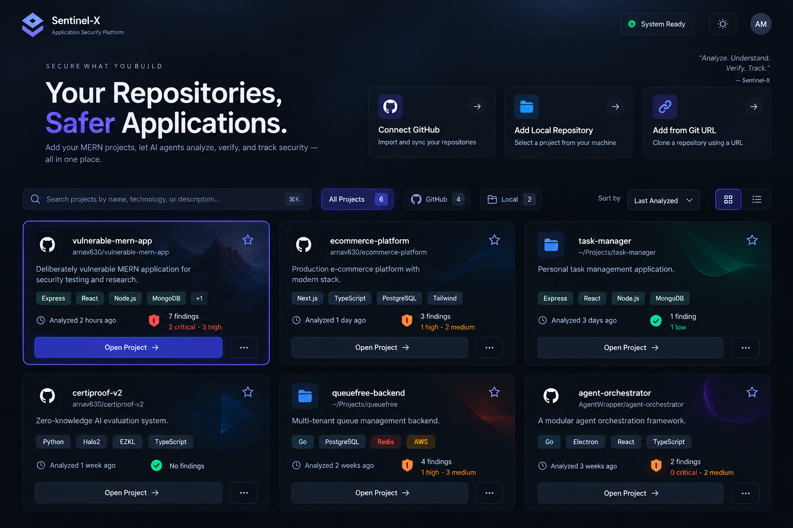
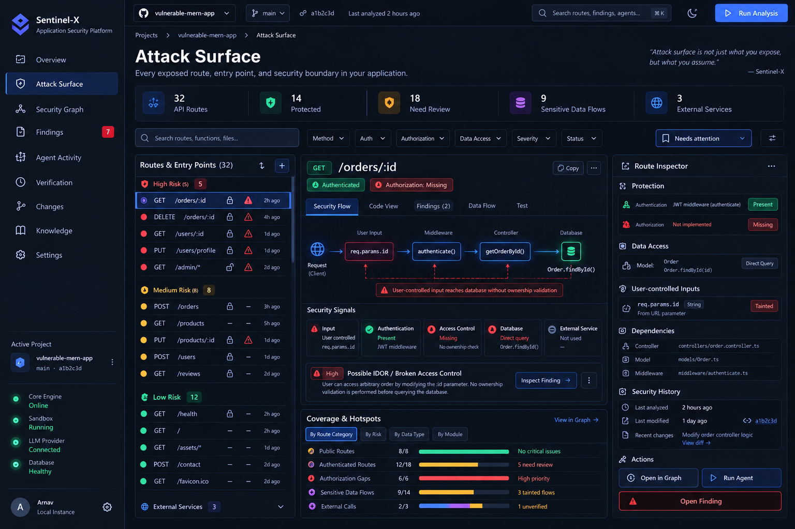
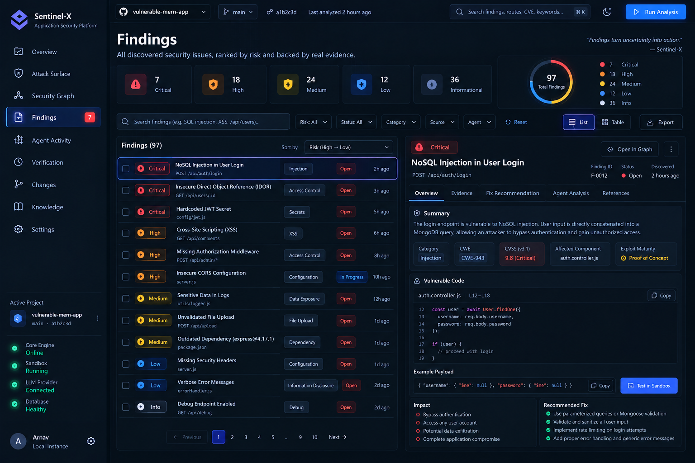
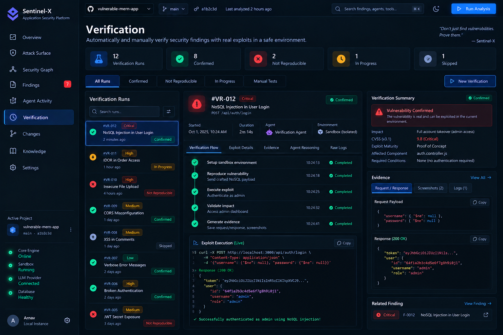

<div align="center">

# 🛡️ Sentinel-X

**Self-hosted agentic application security for MERN stacks**

[](https://www.typescriptlang.org/)
[](https://nodejs.org/)
[](https://docs.docker.com/compose/)
[](https://github.com/langchain-ai/langgraph)
[](LICENSE)

Sentinel-X scans your MERN codebase for security vulnerabilities using a multi-agent LLM pipeline — static indexing, a security graph, specialist agents, and an auto-verification loop — all without ever touching your target code.



</div>

---

## ✨ Features

- 🔍 **Static Code Indexer** — parses Express routes, Mongoose models, middleware chains, and authorization patterns using `ts-morph`
- 🕸️ **Security Graph** — builds a rich call graph of routes, models, and data-flow to surface attack paths
- 🤖 **Specialist LLM Agents** — dedicated agents for Auth, Dataflow, and Attack-Path analysis powered by LangGraph
- 🧪 **Auto-Verification** — confirms findings with real exploit requests against a sandbox target; transitions findings to `resolved` when you fix code
- 👁️ **Always-On Watcher** — scheduler detects file changes and re-runs only affected pipeline stages without human intervention
- 📋 **Security Playbooks** — curated OWASP-aligned markdown playbooks (IDOR, privilege escalation, secret exposure, NoSQL injection, JWT issues, and more)
- 🖥️ **SOC Dashboard** — React + Vite UI streaming live agent reasoning and findings over SSE
- 🐳 **Docker-First** — single `docker compose up` runs the full stack (MongoDB, server, scheduler, sandbox, dashboard)
- 🔌 **Multi-LLM** — swap between Gemini, DeepSeek, or any local Ollama model via `.env`

---

## 📸 Screenshots

<table>
  <tr>
    <td align="center"><br /><sub>Landing UI</sub></td>
    <td align="center"><br /><sub>Attack Surface Map</sub></td>
  </tr>
  <tr>
    <td align="center"><br /><sub>Findings View</sub></td>
    <td align="center"><br /><sub>Auto-Verification Loop</sub></td>
  </tr>
</table>

---

## 🏗️ Architecture

```
sentinel-x/
├── packages/
│   └── engine/src/
│       ├── config/          # Environment & LLM provider config
│       ├── db/              # Mongoose models & connection
│       ├── llm/             # LLM provider abstraction (Gemini · DeepSeek · Ollama)
│       ├── indexer/         # Static AST analysis via ts-morph
│       ├── graph/           # Security graph construction & querying
│       ├── facts/           # Fact extraction tools (per route/model)
│       ├── knowledge/       # Playbook loading, validation & routing
│       ├── tools/           # LangGraph tool registry
│       ├── agents/          # Specialist agents: Auth · Dataflow · Attack-Path
│       ├── orchestrator/    # Full-pipeline orchestration
│       └── change/          # Change detection & impact scoping
├── apps/
│   ├── server/              # Express API + SSE + headless CLI (`sentinel`)
│   └── dashboard/           # React + Vite + Tailwind SOC UI
├── playbooks/               # OWASP-aligned security playbooks (markdown)
└── sandbox/                 # Vulnerable MERN seed app for demos & e2e tests
```

---

## 🚀 Quickstart

### With Docker (recommended)

```bash
git clone https://github.com/your-org/sentinel-x.git
cd sentinel-x

cp .env.example .env
# Edit .env and set GEMINI_API_KEY (or switch LLM_PROVIDER=ollama)

docker compose up --build
```

| Service       | URL / Address              |
| ------------- | -------------------------- |
| Dashboard     | http://localhost:8080       |
| API           | http://localhost:4000       |
| MongoDB       | `127.0.0.1:27018`          |

### Local Development

```bash
cp .env.example .env          # configure your LLM provider

docker compose up -d mongo    # only Mongo in Docker

npm install
npm run dev                   # server :4000 (tsx watch) + dashboard :5173 (Vite)
```

> **Tip:** Set `VITE_API_TARGET` before `npm run dev` if your API runs on a non-default host.

---

## ⚙️ Environment Variables

Copy `.env.example` to `.env` and configure:

| Variable              | Default                          | Description                              |
| --------------------- | -------------------------------- | ---------------------------------------- |
| `PORT`                | `4000`                           | API server port                          |
| `MONGO_URL`           | `mongodb://localhost:27018/sentinelx` | MongoDB connection string           |
| `LLM_PROVIDER`        | `gemini`                         | `gemini` · `deepseek` · `ollama`         |
| `GEMINI_API_KEY`      | —                                | Required when `LLM_PROVIDER=gemini`      |
| `GEMINI_MODEL`        | `gemini-3.8-flash`               | Gemini model name                        |
| `DEEPSEEK_API_KEY`    | —                                | Required when `LLM_PROVIDER=deepseek`    |
| `OLLAMA_URL`          | `http://localhost:11434`         | Ollama server URL                        |
| `OLLAMA_MODEL`        | `llama3.1`                       | Ollama model name                        |
| `SANDBOX_TARGET_URL`  | `http://localhost:3001`          | Target app URL for verification requests |
| `VERIFICATION_ENABLED`| `false`                          | Enable live exploit verification         |
| `PLAYBOOKS_DIR`       | `./playbooks`                    | Path to security playbook directory      |

---

## 🛠️ NPM Scripts

Run from the monorepo root:

| Command | Description |
| ------- | ----------- |
| `npm run dev` | Start server (tsx watch, `:4000`) + dashboard (Vite, `:5173`) in parallel |
| `npm run build` | Build server + dashboard for production |
| `npm run typecheck` | TypeScript typecheck across all workspaces |
| `npm run lint` | ESLint across all workspaces |
| `npm run test` | Vitest across all workspaces |
| `npm run llm:ping` | Smoke-test LLM provider connectivity (reads `.env`) |
| `npm run index -- <path> [--dump routes\|ops\|models\|authz\|json] [--force]` | Index a repo into MongoDB |
| `npm run graph -- <path> [--dump summary\|routes\|route <id>\|find <Type>\|path <from> <to>\|json]` | Build security graph and inspect it |
| `npm run facts -- --list` / `npm run facts -- <path> <tool> ['<json>']` | List or run individual fact tools |
| `npm run knowledge -- list\|show <type>\|match a,b\|validate\|sync\|route <path> '<route>'` | Browse, validate, or sync playbooks |
| `npm run agent -- <path> [--goal "…"] [--provider …] [--model …] [--max-steps N]` | Run a live agent scan with streaming output |

---

## 🖥️ CLI (`sentinel`)

The headless `sentinel` binary is built by `tsup` to `dist/cli.js`.
- **Dev:** `npm run cli -- <command>`
- **Docker:** `docker compose exec server node dist/cli.js <command>`

| Command | Description |
| ------- | ----------- |
| `sentinel load <path> [--force]` | Index a repo and build its security graph |
| `sentinel scan <path\|projectId> [--mode full\|agent] [--agent auth\|dataflow\|attack-path] [--provider ...] [--model ...] [--max-steps N]` | Run a full assessment or a specific agent |
| `sentinel watch <path\|projectId> [--poll-ms N] [--debounce-ms N]` | Watch for file changes and re-verify affected findings |
| `sentinel findings <projectId> [--status open\|resolved\|regressed\|all] [--severity ...] [--json]` | Query and print current findings |

---

## 🔁 Demo: End-to-End Flow

```bash
cp .env.example .env           # set GEMINI_API_KEY
docker compose up --build      # starts: mongo · server · scheduler · sandbox · dashboard

# 1. Load the vulnerable sandbox and scan it
docker compose exec server node dist/cli.js load /app/sandbox
docker compose exec server node dist/cli.js scan <projectId>
docker compose exec server node dist/cli.js findings <projectId>

# 2. Watch the always-on scheduler loop
docker compose logs -f scheduler     # honest idle heartbeat — never fabricated activity

# 3. Fix a vulnerable route in the sandbox, save the file
#    Scheduler detects the change → re-index → impact scope → agent re-run → re-verify → resolved
docker compose exec server node dist/cli.js findings <projectId> --status resolved
```

Open **http://localhost:8080** to follow the same flow in the dashboard.

The three pillars of the demo:

1. **Attack Surface** — routes, middleware chains, models, and unprotected/sensitive endpoints render immediately after indexing
2. **Agentic Investigation** — the Auth agent flags suspicious routes; the dashboard streams its live reasoning over SSE
3. **Verification Loop** — the verifier confirms an IDOR with a real exploit request; fix the code and Sentinel-X automatically transitions the finding to `resolved`

---

## 📚 Security Playbooks

Playbooks live in [`playbooks/`](playbooks/) and drive agent decision-making. Each is an OWASP-aligned markdown document with structured frontmatter.

| Playbook | OWASP | Description |
| -------- | ----- | ----------- |
| `authorization.md` | A01:2025 | Auth & authorization fact interpretation |
| `idor.md` | A01:2025 | Insecure Direct Object Reference |
| `privilege-escalation.md` | A01:2025 | Vertical & horizontal privilege escalation |
| `missing-auth.md` | A01:2025 | Unauthenticated route detection |
| `jwt-security.md` | A02:2025 | JWT misconfiguration & weak signing |
| `secret-exposure.md` | A02:2025 | Hardcoded secrets & credential leaks |
| `mass-assignment.md` | A03:2025 | Mongoose model mass-assignment vulnerabilities |
| `data-exposure.md` | A03:2025 | Sensitive data in API responses |
| `nosql-injection.md` | A03:2025 | MongoDB/NoSQL injection patterns |

---

## 🤝 Contributing

Contributions are welcome! Please follow these steps:

1. Fork the repository
2. Create a feature branch: `git checkout -b feat/your-feature`
3. Commit your changes following [Conventional Commits](https://www.conventionalcommits.org/)
4. Open a Pull Request with a clear description

> **Important:** Sentinel-X is **analysis-only** — PRs must never introduce code that modifies a target codebase.

### Development Requirements

- Node.js ≥ 22
- Docker & Docker Compose
- A Gemini API key, DeepSeek API key, or a local Ollama instance

---

## 📄 License

This project is licensed under the [MIT License](LICENSE).

---

<div align="center">
  <sub>Built with ❤️ — static analysis that reads code, agents that think, and a verifier that proves it.</sub>
</div>
